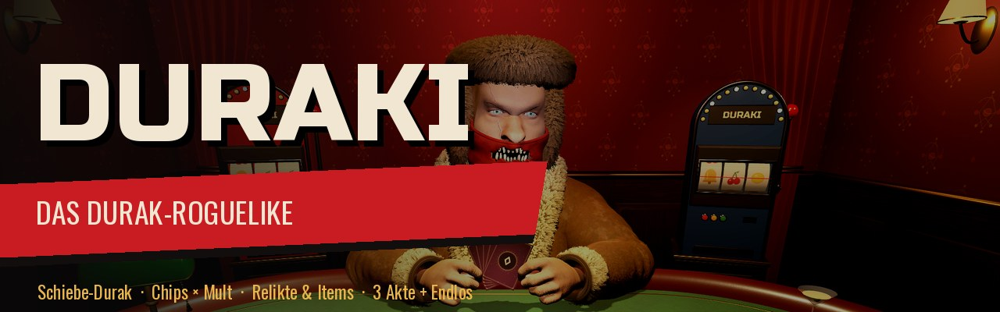
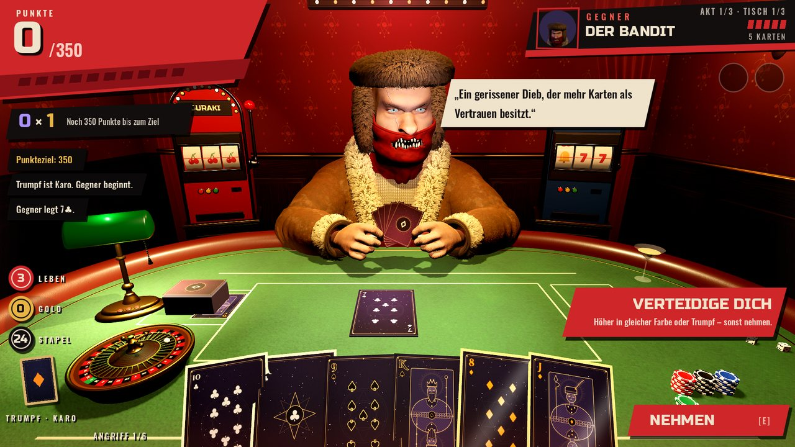
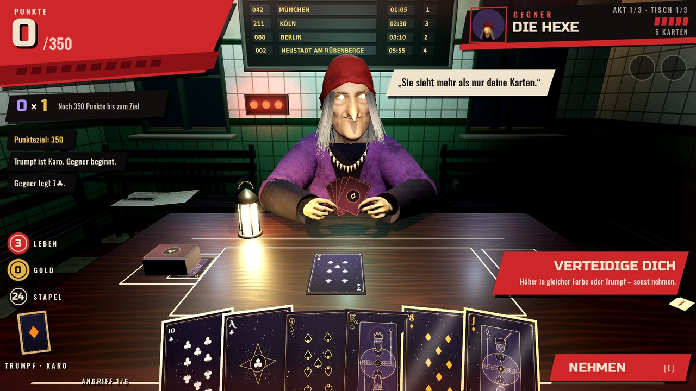
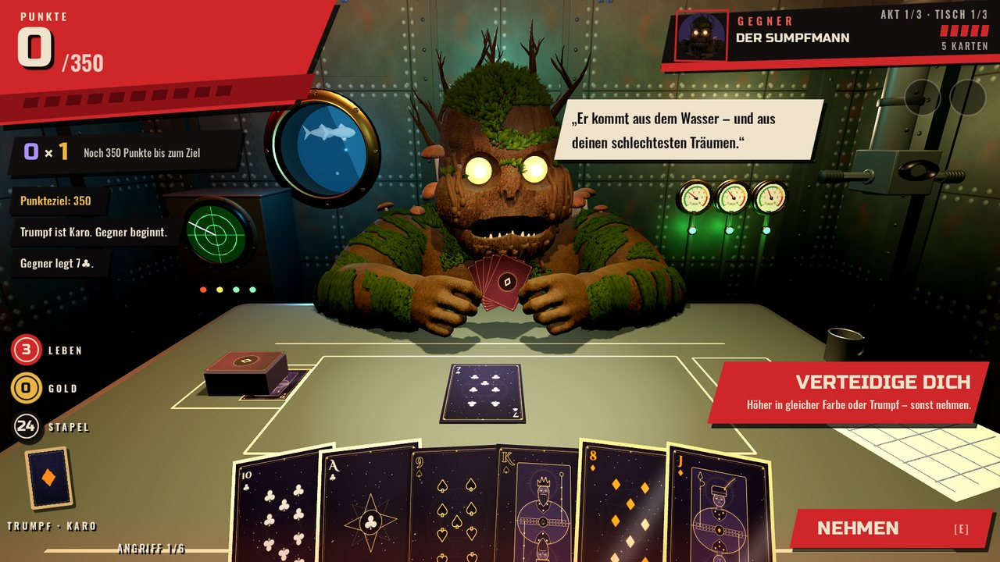
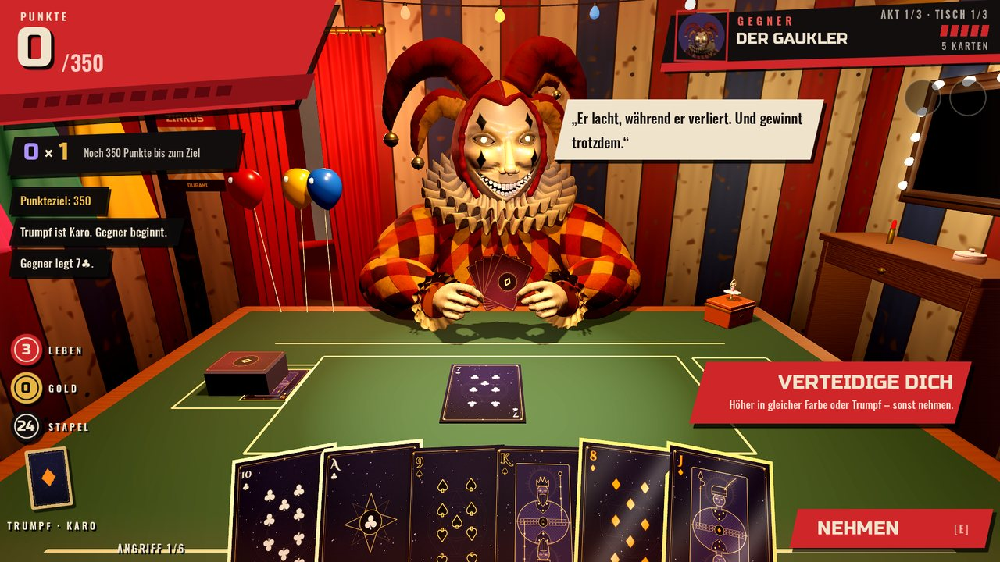
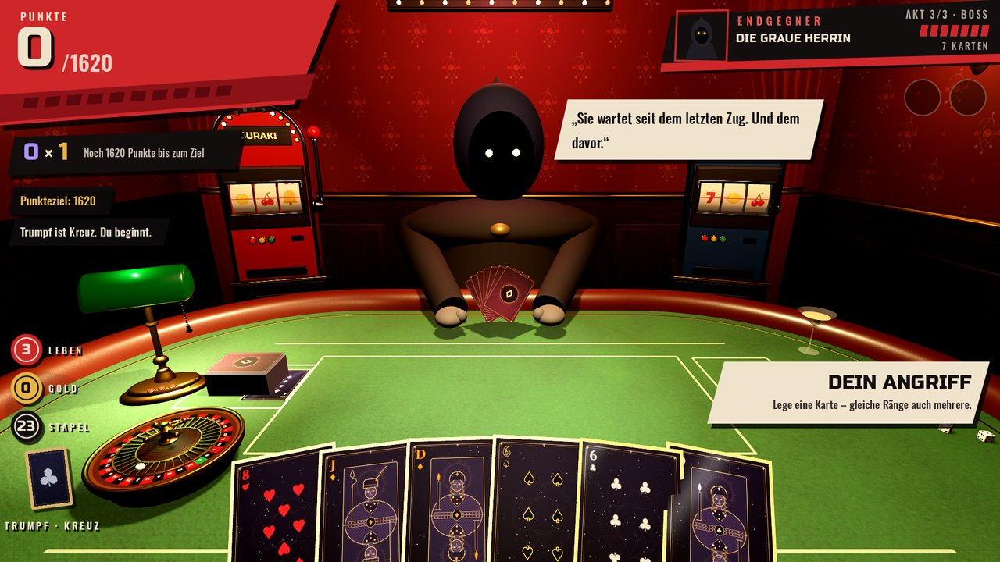
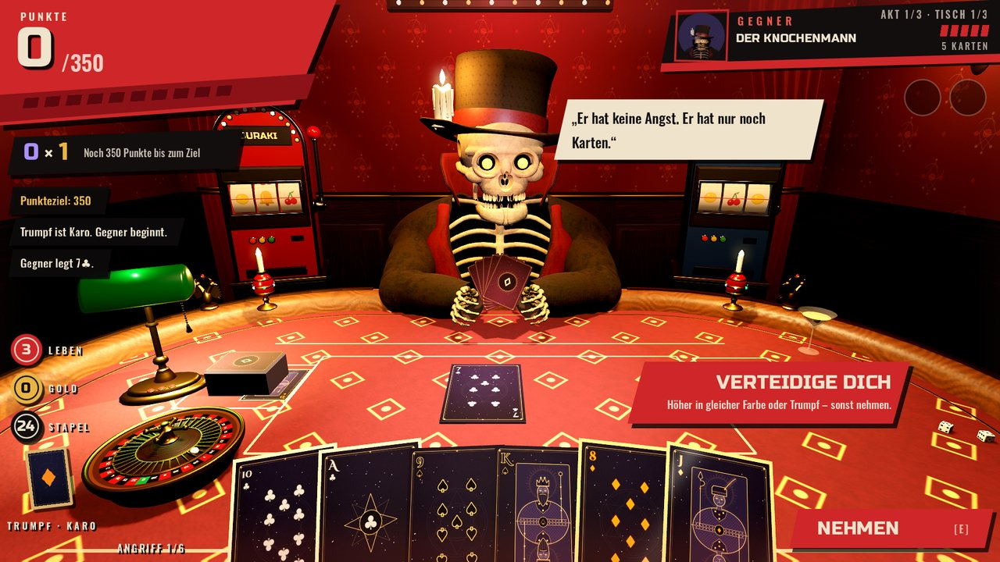
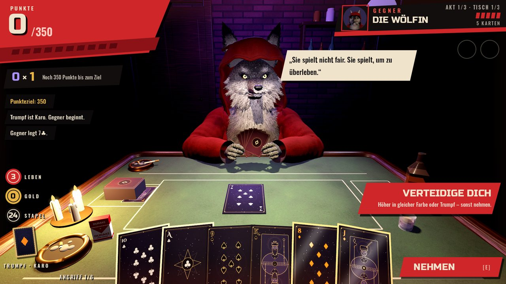
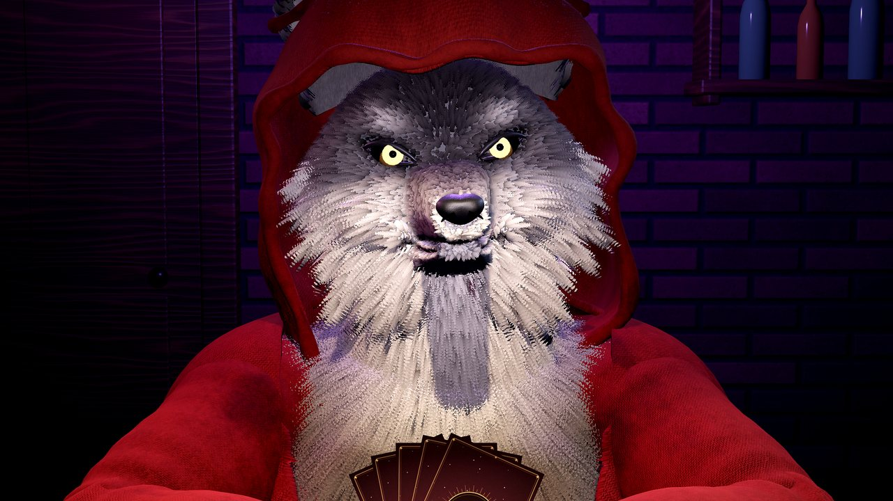

<p align="center">
  
</p>

<p align="center">
  
  
  
  
</p>

<p align="center"><b>
Nachts. Ein verrauchtes Hinterzimmer. Grüner Filz, eine flackernde Lampe – und gegenüber sitzt etwas,<br>
das nicht ganz menschlich ist. Es mischt die Karten. Wer verliert, ist der Durak.
</b></p>

---

## Über dieses Spiel

**DURAKI** ist ein Kartenspiel-Roguelike auf Basis von **Schiebe-Durak** (Perevodnoy), dem Kartenspiel, das in
Russland und Osteuropa in jeder Küche und in jedem Zugabteil gespielt wird. Du sitzt in der Ich-Perspektive an
einem Spieltisch und trittst Nacht für Nacht gegen unheimliche Gestalten an: einen Banditen mit
Pelzmütze, einen Sumpfmann voller Moos, eine Krähe mit Goldkette, eine Wölfin im roten Kapuzenpulli und
noch Schlimmeres.

Gewonnen wird aber nicht nur durch Kartenglück. Jede Runde bringt **Punkte wie bei Balatro: Chips × Mult**.
Schlägst du sauber, schiebst du frech weiter oder zwingst du den Gegner zum Aufnehmen, wächst dein Konto.
Erreichst du das Punkteziel, steht dein Gegner vom Tisch auf. Verfehlst du es, erlischt eine deiner Kerzen.

Zwischen den Tischen wartet der **Händler**: Relikte, die die Regeln zu deinen Gunsten verbiegen, Items mit
kleinen schmutzigen Tricks und Karten aus Gold, Glas oder mit Glücksklee. Drei Akte, drei Bosse, und wer
danach noch eine Kerze hat, spielt im **Endlos-Modus** um einen Platz in der Bestenliste.

---

## Screenshots

<table>
  <tr>
    <td></td>
    <td></td>
  </tr>
  <tr>
    <td align="center"><sub>Altes Casino · Der Bandit</sub></td>
    <td align="center"><sub>Bahnhofswartesaal · Die Hexe</sub></td>
  </tr>
  <tr>
    <td></td>
    <td></td>
  </tr>
  <tr>
    <td align="center"><sub>U-Boot · Der Sumpfmann</sub></td>
    <td align="center"><sub>Zirkuswagen · Der Gaukler</sub></td>
  </tr>
  <tr>
    <td></td>
    <td></td>
  </tr>
  <tr>
    <td align="center"><sub>Akt 3 · Endgegner</sub></td>
    <td align="center"><sub>Deck-Belohnungen: Filz, Rand, Doppeladler, Fabergé-Leuchter</sub></td>
  </tr>
  <tr>
    <td></td>
    <td></td>
  </tr>
  <tr>
    <td align="center"><sub>Hinterzimmer · Die Wölfin</sub></td>
    <td align="center"><sub>Sie spielt nicht fair. Sie spielt, um zu überleben.</sub></td>
  </tr>
</table>

---

## Features

- 🃏 **Echtes Schiebe-Durak.** 36 Karten, Trumpf, Angreifen, Nachlegen, Schlagen, Nehmen, Fertig, dazu
  **Schieben** und **Nachwerfen**. Die Regeln sind nicht verwässert, sondern so, wie man sie am Küchentisch
  spielt.
- 💥 **Wertung wie bei Balatro.** Jede Karte bringt Chips, Verteidigungen, Nachlegen und Trümpfe treiben den
  Mult nach oben. Zwingst du den Gegner zum Aufnehmen, gibt es einen **Volltreffer ×2**.
- 🕯️ **Ein ganzer Run in einer Nacht.** 3 Akte mit je 3 Gegnern und einem Boss, Leben als Kerzen auf dem
  Tisch, Gold, Zinsen und ein Händler nach jedem Sieg.
- 🗿 **Unheimliche Gegner mit Persönlichkeit.** Jede Gestalt hält ihre Karten als Fächer, überlegt, trommelt
  mit den Fingern, lacht dich aus, wenn du aufnehmen musst, und sackt zusammen, wenn sie verliert.
- 🏚️ **Fünf Räume.** Hinterzimmer, Altes Casino, Bahnhofswartesaal, U-Boot und Zirkuswagen. In vielen
  gibt es etwas zum Anklicken: Roulette, Spielautomat, Periskop, Spieluhr – und im Hinterzimmer die
  Zigaretten.
- 🔮 **11 Relikte und 8 Items.** Vom *Ass im Ärmel* bis zur *Matrjoschka*, vom *Feuerzeug*, das Gegnerkarten
  verbrennt, bis zum *Spiegel*, der hinter dem Gegner vorbeischwebt und dir eine seiner Karten verrät.
- ✨ **Karten-Verbesserungen.** Goldkarten bringen Gold, Glaskarten doppelte Chips, Glückskarten mit etwas
  Glück +5 Mult.
- 🎴 **12 Decks mit eigenem Effekt** und 36 freischaltbare **Tisch-Belohnungen**: Filze, Ränder, Totenköpfe,
  eine Krähe auf dem Tisch, goldene Doppeladler und ein Fabergé-Leuchter.
- 📅 **Tägliche Herausforderung.** Jeden Tag ein fester Run mit dem Deck des Tages. Alle haben dieselbe
  Ausgangslage, drei Versuche, der beste zählt.
- ♾️ **Endlos-Modus und Bestenliste.** Nach dem dritten Boss geht es weiter, Deck um Deck, bis die letzte
  Kerze ausgeht.
- 🏆 **16 Erfolge**, 7 davon geheim.
- 🚩 **Stil „Plakat“.** HUD und Menüs im Look des russischen Konstruktivismus: Rot, Schwarz und Creme,
  schräge Flächen und kräftige Schrift.

---

## So spielt sich ein Duell

| | |
|---|---|
| **1. Angreifen** | Wer am Zug ist, legt eine Karte (oder mehrere gleichen Rangs). Weitere Karten mit Rängen, die schon auf dem Tisch liegen, darfst du jederzeit nachlegen. |
| **2. Verteidigen** | Der Gegner schlägt jede Karte mit einer höheren derselben Farbe oder mit Trumpf. Wenn er nicht kann oder will, nimmt er alles auf. |
| **3. Schieben** | Solange noch nichts geschlagen ist, darf der Verteidiger eine Karte **gleichen Rangs** dazulegen. Dann muss der Angreifer sich gegen alles verteidigen. |
| **4. Nachwerfen** | Nimmt der Verteidiger auf, darf der Angreifer noch passende Karten hinterherwerfen. Die muss er auch schlucken. |
| **5. Fertig** | Ist alles geschlagen, wandern die Karten weg und der Verteidiger greift als Nächstes an. Beide ziehen auf ihre Handgröße nach. |
| **6. Durak** | Ist der Stapel leer, verliert, wer als Letzter noch Karten hat. Im Run zählt aber vor allem dein **Punkteziel**. |

**Wertung pro Runde:** Chips aus deinen Karten × Mult. Verteidigungen, nachgelegte Karten und Trümpfe
bringen Mult. Muss der Gegner aufnehmen, verdoppelt sich die Runde. Musst du aufnehmen, verfällt sie. Ist
der Gegner am Ende Durak, gibt es noch einen Bonus für jede Karte, die er auf der Hand hat.

---

## Die Gegner

| Gegner | |
|---|---|
| **Der Bandit** | *„Ein gerissener Dieb, der mehr Karten als Vertrauen besitzt.“* |
| **Der Sumpfmann** | *„Er kommt aus dem Wasser – und aus deinen schlechtesten Träumen.“* |
| **Die Krähe** | *„Sie beobachtet. Sie wartet. Und sie kennt deine Züge.“* |
| **Die Wölfin** | *„Sie spielt nicht fair. Sie spielt, um zu überleben.“* |
| **Der Gaukler** | *„Er lacht, während er verliert. Und gewinnt trotzdem.“* |
| **Der Knochenmann** | *„Er hat keine Angst. Er hat nur noch Karten.“* |
| **Die Hexe** | *„Sie sieht mehr als nur deine Karten.“* |
| **Der Riese** · Boss | *„Er ist langsam. Aber er vergisst nie.“* |

Bis alle Gegner fertig modelliert sind, sitzen auch ein paar Platzhalter-Gestalten mit am Tisch: *Der
Fremde*, *Die Fremde* und als Bosse *Der Schattenfürst* und *Die Graue Herrin*.

---

## Händler, Relikte und Items

**Relikte** wirken den ganzen Run: *Ass im Ärmel* (+1 Handkarte), *Glücksmünze* (+5 Gold pro Sieg), *Med-Kit*
(+1 Leben), *Wodka* (+1 Mult in jeder Runde), *Gezinkter Würfel*, *Hufeisen*, *Wolfszahn*, *Wirbel*,
*Sparstrumpf*, *Böser Blick* (der Gegner startet mit einer Karte weniger) und *Matrjoschka* (nach jedem
Sieg wird eine Karte deines Decks verbessert).

**Items** setzt du einmal im Duell ein (höchstens zwei gleichzeitig):

| | Item | Wirkung |
|---|---|---|
| 🔥 | **Feuerzeug** | Verbrennt eine Gegnerkarte auf dem Tisch, er muss neu legen. |
| 🪞 | **Spiegel** | Schwebt hinter dem Gegner vorbei und verrät dir eine Karte seiner Hand. |
| 🧲 | **Magnet** | Holt eine zufällige Karte vom Ablagestapel auf deine Hand. |
| 🥃 | **Runde Schnaps** | Der Gegner trinkt mit und spielt bis zum Ende der Runde betrunken. |
| 🔄 | **Kartentausch** | Eine Handkarte gegen die offene Trumpfkarte unter dem Stapel tauschen. |
| 🎭 | **Maske** | Deine nächste Punkterunde zählt doppelt. |
| 🪤 | **Falle** | Der Gegner darf in dieser Runde nicht weiterschieben. |
| 💰 | **Bestechung** | Sofort +50 Punkte. |

Nach jedem Boss gibt der Händler **30 % Rabatt** auf alles und schenkt dir vorher ein Relikt nach Wahl.

---

## Decks, Seelen und Belohnungen

Jeder besiegte Gegner schaltet sein **Deck** frei: einen eigenen Kartenrücken mit einem kleinen Vorteil,
zum Beispiel +6 Start-Gold, eine Kerze mehr, +3 Chips für eine Farbe oder zwei Glaskarten im Stapel. Drei
weitere Decks (*Kaufmann*, *Zar*, *Goldrand*) kaufst du mit **Seelen**, die du am Ende jedes Runs bekommst.

Gewinnst du einen Run mit einem Deck auf **Leicht, Normal oder Schwer**, bekommt es ein Abzeichen, und
jedes Abzeichen schaltet eine **Tisch-Belohnung** frei, die du in jedem Raum anlegen kannst: Tischfilze,
Tischränder, Tischecken, Extras, eigene Zigaretten und Münzen.

---

## Spielmodi

- **Run** – 3 Akte, 3 Bosse, Schwierigkeit *Leicht / Normal / Schwer*. Wer die Hinweise ausschaltet (spielbare
  Karten leuchten dann nicht mehr), bekommt ×1,5 Seelen.
- **Endlos-Modus** – nach dem 3. Boss: kein Punkteziel mehr, gespielt wird, bis du selbst Durak bist.
  Jedes geschlagene Deck bringt Gold und einen neuen Gegner.
- **Tägliche Herausforderung** – ein Run pro Tag mit festem Seed und dem Deck des Tages, drei Versuche,
  der beste zählt. Serie und Bestwert stehen in der Statistik.
- **Tutorial** – eine geführte Übungsrunde gegen den Gaukler, die auch Relikte, Items und den Händler erklärt.

---

## Systemanforderungen

| | Minimum (vorläufig) |
|---|---|
| **System** | Windows 10/11 (Linux und macOS über Godot möglich) |
| **Grafik** | OpenGL 3.3 (Godot „GL Compatibility“), auch Onboard-Grafik |
| **Speicher** | 4 GB RAM (geschätzt), ca. 1 GB frei |
| **Eingabe** | Maus und Tastatur |
| **Internet** | nicht nötig |

Einen fertigen Download gibt es noch nicht. Gestartet wird das Spiel aus dem Repo (siehe unten).

---

## Für Entwickler

<details>
<summary><b>Loslegen</b></summary>

1. **Godot 4.7.2** herunterladen (Standard-Version, nicht .NET): https://godotengine.org/download
2. Repo klonen:
   ```bash
   git clone https://github.com/beydo7/duraki.git
   ```
3. Godot starten → **Importieren** → `project.godot` auswählen → **F5**.

**Ohne Editor:** Doppelklick auf `Spiel_starten.bat`. Die Godot-exe wird gefunden, wenn sie in einem Ordner
`Godot` neben dem Repo liegt (oder über die Umgebungsvariable `GODOT`):

```
Duraki\
  Godot\Godot_v4.7.2-stable_win64.exe
  duraki\            ← dieses Repo
    Spiel_starten.bat
```

Einzelne Szenen startet **F6** im Editor, z. B. `scenes/match/match.tscn` (Duell gegen einen Testgegner).
Im Editor und in Debug-Exporten öffnet **F8** das Entwicklermenü (Karten, Items, Relikte, Gold, Gegner
überspringen, alles freischalten). Im fertigen Spiel ist es aus.
</details>

<details>
<summary><b>Projektstruktur</b></summary>

| Pfad | Inhalt |
|---|---|
| `scripts/core/` | Spiellogik ohne UI: `Card`, `Deck`, `DurakRules`, `DurakMatch`, `ScoreTracker` |
| `scripts/ai/` | Gegner-KI (`SimpleAI`) |
| `scripts/data/` | Ressourcen-Typen: `OpponentData`, `RelicData`, `DeckData`, `Cosmetics` (Tisch-Belohnungen) |
| `scripts/autoload/` | Globale Dienste: `Run` (Run-Zustand), `Settings`, `Profile` (Seelen, Decks, Statistik), `Pause`, `Fade` |
| `scenes/match/` | 3D-Duell: `table_world.gd` (Raum, Licht, Kamera, Karten), `card_3d.gd`, `opponent_figure.gd`, `hud.gd` (komplettes HUD im Code), `match.gd` (Ablauf), `table_skin.gd` (Belohnungen am Tisch) |
| `scenes/match/rooms/` | Casino, Bahnhof, U-Boot, Zirkuswagen (`RoomKit` setzt die Blender-Modelle zusammen) |
| `scenes/menu/`, `scenes/run/` | 3D-Hauptmenü, Weg, Händler, Run-Ende |
| `ui/` | Theme, Plakat-Bausteine (`slab.gd`, `roundel.gd`, `seg_bar.gd`), `ui_kit.gd`, Menüs |
| `data/` | Gegner, Relikte und Decks als `.tres` (neue werden automatisch geladen) |
| `assets/` | Kartenbilder, Schriften, Porträts, Sounds, 3D-Modelle (`.glb`, nicht direkt bearbeiten) |
| `art/blender/` | Blender-Quellen (`.blend`) und Build-Skripte der Modelle |
| `tools/` | Generatoren für Kartenbilder, Sounds, Symbole und Texturen (Python + Pillow + numpy) |
| `tests/` | Regeltests, Ablauftests, Autoplay, Klicktest, Screenshots |
| `docs/` | `GD.md` (Game Design und aktueller Stand), `CHARAKTERE.md`, `UMGEBUNG_OVERHAUL.md` |

**Grundprinzip:** Die Regeln (`DurakMatch`) kennen keine UI. Szenen hören auf die Signale `changed`,
`message` und `finished` und rufen nur Aktionen wie `attack()`, `defend()`, `transfer()`, `take()` und
`pass_bout()` auf. So bleiben die Regeln testbar.
</details>

<details>
<summary><b>Tests</b></summary>

```bash
godot --headless --path . -s res://tests/run_tests.gd        # Regeln, Items, Relikte, KI
godot --headless --path . res://tests/flow_tests.tscn        # Ablauf: Doppeldruck, Händler, Aufgeben, Tägliche …
godot --headless --path . res://tests/deck_tests.tscn        # Decks, Seelen, Schwierigkeit, Abzeichen
godot --headless --path . res://tests/relic_tests.tscn       # jedes Relikt im echten Ablauf
godot --headless --path . res://tests/daily_tests.tscn       # Tägliche Herausforderung, Statistik
godot --headless --path . res://tests/cosmetics_tests.tscn   # Tisch-Belohnungen in allen Räumen
godot --headless --path . res://tests/casino_tests.tscn      # Casino-Modelle
godot --headless --path . res://tests/rooms_tests.tscn       # Bahnhof, U-Boot, Zirkuswagen
godot --headless --path . res://tests/tutorial_test.tscn     # Tutorial komplett durchspielen
godot --headless --path . res://tests/autoplay.tscn          # komplette Runs (DURAKI_DIFF, DURAKI_RUNS)
godot --headless --path . res://tests/hand_fuzz.tscn         # Zufallsspiel: Handkarten ohne Lücken oder Hänger

# brauchen ein echtes Fenster (kein --headless):
godot --path . res://tests/click_test.tscn                   # klickt eine Handkarte an (auch sehr schnell)
godot --path . res://tests/screenshot.tscn -- opp=wolf       # Duell-Screenshot gegen einen Gegner
godot --path . res://tests/screenshot.tscn -- room=casino skin=felt_wine,corner_eagles
godot --path . res://tests/ui_shots.tscn                     # Menü, Optionen, Decks, Erfolge, Weg, Händler, Ende
```

Die genaue Anzahl der Checks steht in [`docs/GD.md`](docs/GD.md), Abschnitt Tests.
</details>

<details>
<summary><b>Gegner, Räume und 3D-Modelle (Blender)</b></summary>

Jede Figur hat ein eigenes Build-Skript (`art/blender/hd_<id>.py`), eine `.blend` in `art/blender/opponents/`
und einen Export nach `assets/models/opponents/<id>.glb`. Die Räume (`casino.py`, `station.py`,
`submarine.py`, `circus.py`), die Kleinteile am Tisch (`table_small.py`) und die Tisch-Belohnungen
(`cosmetics.py`) entstehen genauso.

```bash
pip install bpy numpy pillow                             # Blender als Python-Modul
python art/blender/build_models.py --rebuild wolf        # einen Gegner neu bauen (überschreibt die .blend!)
python art/blender/render_portraits.py wolf              # Porträt für das HUD neu rendern
```

**Unter Windows ohne Konsole:** `.blend` in Blender bearbeiten, speichern, dann Doppelklick auf
`Modelle_exportieren.bat` (alle Modelle) bzw. `Modelle_exportieren.bat wolf` (nur eines).

Godot setzt Figuren und Räume über **Objekt- und Materialnamen** zusammen. Die Namen also nicht ändern.
Das vollständige Rezept steht in [`docs/CHARAKTERE.md`](docs/CHARAKTERE.md) und
[`docs/UMGEBUNG_OVERHAUL.md`](docs/UMGEBUNG_OVERHAUL.md).
</details>

<details>
<summary><b>Zusammenarbeit</b></summary>

- `main` ist immer spielbar. Vor dem Arbeiten `git pull`.
- Größere Features in einem eigenen Branch und per Pull Request.
- Möglichst nicht gleichzeitig an derselben `.tscn` oder `.blend` arbeiten, beides lässt sich schlecht mergen.
- `.godot/` ist lokal und wird nicht committet, `.uid`- und `.import`-Dateien dagegen schon.
- Wer mit Claude arbeitet: zuerst [`CLAUDE.md`](CLAUDE.md) und [`docs/GD.md`](docs/GD.md) lesen lassen.
</details>

---

## Team

| | |
|---|---|
| **Entwicklung** | [beydo7](https://github.com/beydo7) (Pascal), [Florry7](https://github.com/Florry7), Leon |
| **Engine** | [Godot 4.7.2](https://godotengine.org) |
| **3D** | [Blender](https://www.blender.org) |
| **Schriften** | Russo One, Oswald, Cinzel Decorative u. a. (SIL Open Font License, siehe `assets/fonts/`) |

## Lizenz

Alle Rechte vorbehalten. Schriften: SIL Open Font License (siehe `assets/fonts/`).
